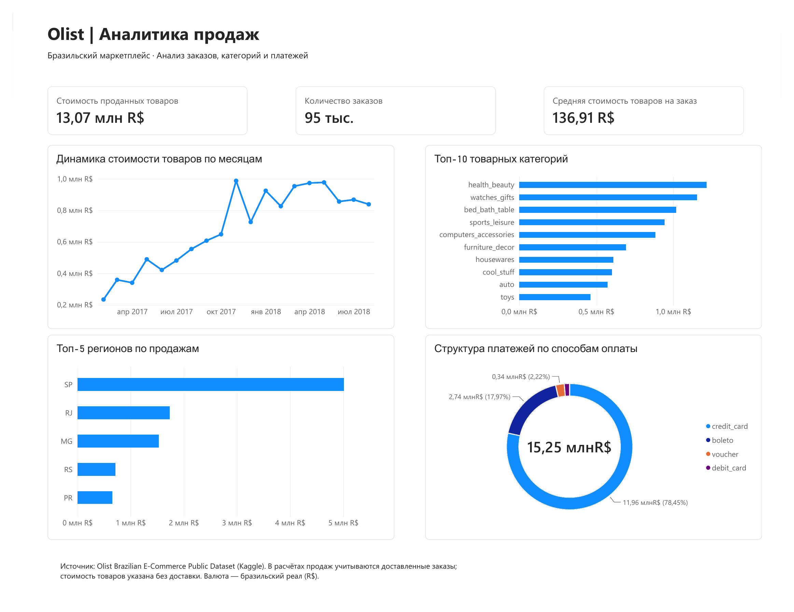

# Olist Sales Analytics | Аналитика продаж

Учебный портфолио-проект на **PostgreSQL, SQL и Power BI**: анализ продаж, категорий, регионов и способов оплаты бразильского маркетплейса Olist.

## Задача
Исследовать данные заказов, рассчитать ключевые бизнес-показатели, проанализировать динамику стоимости товаров, распределение продаж по регионам и категориям и представить результаты в Power BI.

## Данные
Источник: [Brazilian E-Commerce Public Dataset by Olist (Kaggle)](https://www.kaggle.com/datasets/olistbr/brazilian-ecommerce). Используются семь таблиц: `customers`, `orders`, `order_items`, `order_payments`, `products`, `sellers`, `category_translation`.

Исходный датасет содержит около 100 тыс. заказов за 2016–2018 годы. Оригинальные CSV не хранятся в этом репозитории.

## Методология
Период аналитики: **01.01.2017–31.08.2018** по дате оформления заказа `order_purchase_timestamp`. Рассматриваются только заказы со статусом `delivered`.

- **Стоимость товаров** — `SUM(order_items.price)` без стоимости доставки; это не бухгалтерская выручка.
- **Количество заказов** — `COUNT(DISTINCT order_id)`.
- **Средняя стоимость товаров на заказ** — стоимость товаров / количество доставленных заказов.
- **Сумма платежей** — `SUM(order_payments.payment_value)`, включает в том числе доставку и может содержать несколько платежей на заказ.
- **Клиенты** — `customer_id` соответствует записи покупателя для конкретного заказа; для идентификации одного человека между заказами используется `customer_unique_id`.

## Результаты Power BI
Значения округлены и перенесены из итогового снимка отчёта; требуют независимой сверки при воспроизведении SQL:

| Показатель | Значение |
| --- | ---: |
| Стоимость товаров в доставленных заказах | ≈ 13,07 млн R$ |
| Количество доставленных заказов | ≈ 95 тыс. |
| Средняя стоимость товаров на заказ | ≈ 136,91 R$ |
| Сумма платежей | ≈ 15,25 млн R$ |

Наибольшую стоимость товаров формируют покупатели из São Paulo (SP). Среди ведущих категорий — `health_beauty`, `watches_gifts`, `bed_bath_table`. Основной способ оплаты по сумме — `credit_card`.

Эти результаты описывают наблюдаемые различия; сами по себе они не доказывают причинно-следственные связи.

## Дашборд Power BI

Итоговый одностраничный отчёт содержит три KPI и четыре визуализации: динамику стоимости товаров, топ-10 категорий, топ-5 регионов и структуру платежей. Период анализа: январь 2017 — август 2018 года.



- **[Посмотреть готовый отчёт (PDF)](dashboard/Olist_Sales_Analytics.pdf)** — доступен для просмотра без установки Power BI.
- **[Скачать интерактивный проект Power BI (.pbix)](dashboard/Olist_Sales_Analytics.pbix)** — для открытия в Power BI Desktop.
- **[Модель данных и формулы DAX](docs/POWER_BI.md)**.

## Структура
```text
sql/
  01_schema.sql
  02_data_quality.sql
  03_sales_overview.sql
  04_monthly_sales.sql
  05_regional_sales.sql
  06_category_sales.sql
  07_payment_methods.sql
docs/
  POWER_BI.md
dashboard/
  Olist_Sales_Analytics.pbix
  Olist_Sales_Analytics.pdf
```


## Как воспроизвести
1. Установить PostgreSQL, создать пустую базу `olist_analytics`.
2. Выполнить `sql/01_schema.sql` **только в пустой базе**, затем импортировать CSV:
   - `olist_customers_dataset.csv` → `customers`
   - `olist_orders_dataset.csv` → `orders`
   - `olist_order_items_dataset.csv` → `order_items`
   - `olist_order_payments_dataset.csv` → `order_payments`
   - `olist_products_dataset.csv` → `products`
   - `olist_sellers_dataset.csv` → `sellers`
   - `product_category_name_translation.csv` → `category_translation`
3. Проверить целостность загрузки в `02_data_quality.sql`.
4. Выполнить остальные SQL-файлы по порядку.
5. В Power BI Desktop подключиться к PostgreSQL, загрузить семь таблиц и настроить модель по `docs/POWER_BI.md`.

## Ограничения
- Это исторические данные, не текущие показатели Olist.
- Период задаётся датой оформления заказа, а не датой доставки.
- Один заказ может содержать несколько товарных категорий; суммы количества заказов по категориям нельзя трактовать как общее количество уникальных заказов.
- Доля способов оплаты, вычисленная из количества заказов с каждым способом, не обязана суммироваться до 100%: один заказ может использовать более одного способа.
- Визуализация категорий на основе `category_translation` может исключать товары без перевода; SQL использует `COALESCE`.

## Инструменты
PostgreSQL · DBeaver · SQL · Power BI Desktop · Power Query · DAX.
